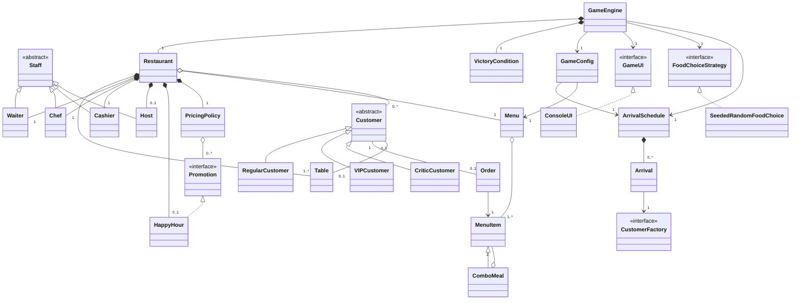

# Class Diagram Reference (final, Stage 3)

Every class in `src/`, with attributes, operations, visibility and relationships, taken from the
Stage 3 code. Use it to draw the class diagram so that it matches the code exactly.

Visibility: `+` public, `-` private, `#` protected, `~` package-private. Static members are
<u>underlined</u> in UML (marked *static* here). `{readOnly}` = `final` field.

## 1. Relationships and multiplicities

### Inheritance (generalisation)
| Subclass | Superclass |
|----------|------------|
| `RegularCustomer`, `VIPCustomer`, `CriticCustomer` | `Customer` (abstract) |
| `Waiter`, `Chef`, `Cashier`, `Host` | `Staff` (abstract) |
| `ComboMeal` | `MenuItem` |

### Interface realisation
| Class | Interface |
|-------|-----------|
| `ConsoleUI` (and test `ScriptedUI`, `GreedyUI`) | `GameUI` |
| `SeededRandomFoodChoice` (and test `FixedFoodChoice`) | `FoodChoiceStrategy` |
| `HappyHour` | `Promotion` |
| constructor references `RegularCustomer::new`, `VIPCustomer::new`, `CriticCustomer::new` | `CustomerFactory` |

### Composition (filled diamond: the whole creates and owns the part)
| Whole | Part | Multiplicity (whole → part) | Field |
|-------|------|------------------------------|-------|
| `Restaurant` | `Table` | 1 → 1..* (2 in the base setting) | `tables` |
| `Restaurant` | `Waiter` | 1 → 1 | `waiter` |
| `Restaurant` | `Chef` | 1 → 1 | `chef` |
| `Restaurant` | `Cashier` | 1 → 1 | `cashier` |
| `Restaurant` | `Host` | 1 → 0..1 (1 in Stage 3) | `host` |
| `Restaurant` | `HappyHour` | 1 → 0..1 (1 in Stage 3) | `happyHour` |
| `Restaurant` | `PricingPolicy` | 1 → 1 | `pricingPolicy` |
| `GameEngine` | `Restaurant` | 1 → 1 | `restaurant` |
| `GameEngine` | `VictoryCondition` | 1 → 1 | `victoryCondition` |
| `ArrivalSchedule` | `ArrivalSchedule.Arrival` | 1 → 0..* (6 in the base setting) | `arrivals` |
| `Customer` | `Order` | 1 → 0..1 | `order` (created by `Waiter.takeOrder`) |

### Aggregation / association (hollow diamond or plain line)
| From | To | Multiplicity | Field / meaning |
|------|----|--------------|-----------------|
| `Restaurant` | `Menu` | 1 → 1 | `menu` (built by `GameConfig`, passed in) |
| `Restaurant` | `Customer` | 1 → 0..* | `customers` (everyone who arrived) |
| `Restaurant` | `Customer` | 1 → 0..* | `waitingQueue` (subset still waiting for a table) |
| `Menu` | `MenuItem` | 1 → 1..* | `items` |
| `ComboMeal` | `MenuItem` | 1 → 2 | `first`, `second` |
| `PricingPolicy` | `Promotion` | 1 → 0..* | `promotions` (the restaurant's `HappyHour`) |
| `Order` | `Customer` | 0..1 ↔ 1 | `customer` / `Customer.order` (bidirectional) |
| `Order` | `MenuItem` | * → 1 | `item` |
| `Customer` | `Table` | 0..1 ↔ 0..1 | `Customer.table` / `Table.occupant` (bidirectional while seated) |
| `GameEngine` | `GameConfig` | 1 → 1 | `config` |
| `GameEngine` | `GameUI` | 1 → 1 | `ui` (interface: DIP) |
| `GameEngine` | `FoodChoiceStrategy` | 1 → 1 | `foodChoice` (interface: DIP) |
| `GameEngine` | `ArrivalSchedule` | 1 → 1 | `arrivals` (from the config) |
| `GameConfig` | `ArrivalSchedule` | 1 → 1 | `arrivalSchedule` |
| `GameConfig` | `Menu` | 1 → 1 | `menu` |
| `ArrivalSchedule.Arrival` | `CustomerFactory` | 1 → 1 | `factory` |
| `Customer` | `CustomerStatus` | * → 1 | `status` |
| `Order` | `OrderStatus` | * → 1 | `status` |

### Dependencies (dashed arrow: uses as parameter / return / local)
- `Main` → `GameConfig`, `GameEngine`, `ConsoleUI`, `SeededRandomFoodChoice` (creates and wires them).
- `Waiter`, `Host`, `Chef`, `Cashier` → `Restaurant`, `Customer`, `ActionResult`; `Waiter` → `PricingPolicy`, `FoodChoiceStrategy`, `Order`.
- `GameEngine` → `HostCommand`, `WaiterCommand`, `ChefCommand`, `ActionResult`, `GameResult`, `Customer`, `Host`, `HappyHour`.
- `GameUI` / `ConsoleUI` → `Restaurant`, `GameConfig`, `Menu`, `GameResult`, `HostCommand`, `WaiterCommand`, `ChefCommand`, `HappyHour`.
- `VictoryCondition` → `Restaurant`, `GameResult`. `PricingPolicy` → `Customer`, `MenuItem`.
- `HostCommand`, `WaiterCommand`, `ChefCommand` → `CommandParsing`. `Money` is used by many classes for display.

### Overview (Mermaid; GitHub renders it)

## 2. Classes by package

### `restaurant.domain` (entities)

**`Customer`** *(abstract)*
| Attributes | Operations |
|------------|------------|
| `+MAX_SATISFACTION: int = 100` *static, readOnly* | `#Customer(id: String, arrivalTurn: int)` |
| `-NOT_YET: int = -1` *static, readOnly* | `+getSatisfactionLossPerTurn(): int` *abstract* |
| `-id: String` {readOnly} | `+getTypeName(): String` *abstract* |
| `-arrivalTurn: int` {readOnly} | `+calculateBill(item: MenuItem): int` |
| `-satisfaction: int = 100` | `+chooseDish(menu: Menu, defaultChoice: FoodChoiceStrategy): MenuItem` |
| `-status: CustomerStatus = WAITING` | `+isWaitingForService(): boolean` |
| `-table: Table` | `+hasBeenServed(): boolean` |
| `-order: Order` | `~loseSatisfaction(): void` |
| `-servedOnTurn: int = -1` | `~recoverSatisfaction(points: int): void` |
| `-readyToPayOnTurn: int = -1` | `~seatAt(table: Table): void` |
| `-satisfactionAtPayment: int = -1` | `~placeOrder(order: Order): void` |
| | `~markServed(turn: int): void` |
| | `~finishEating(turn: int): void` |
| | `~markPaid(): void` |
| | `~leave(): void` |
| | `-requireStatus(expected: CustomerStatus): void` |
| | `+getId(): String`, `+getArrivalTurn(): int`, `+getSatisfaction(): int`, `+getStatus(): CustomerStatus`, `+getTable(): Table`, `+getOrder(): Order`, `+getServedOnTurn(): int`, `+getReadyToPayOnTurn(): int`, `+getSatisfactionAtPayment(): int`, `+toString(): String` |

**`RegularCustomer`** extends `Customer`: `-SATISFACTION_LOSS: int = 8` *static*; `+RegularCustomer(id: String, arrivalTurn: int)`, `+getSatisfactionLossPerTurn(): int`, `+getTypeName(): String`.

**`VIPCustomer`** extends `Customer`: `-SATISFACTION_LOSS: int = 5` *static*, `-DISCOUNT_PERCENT: int = 10` *static*; `+VIPCustomer(id: String, arrivalTurn: int)`, `+getSatisfactionLossPerTurn(): int`, `+getTypeName(): String`, `+calculateBill(item: MenuItem): int`.

**`CriticCustomer`** extends `Customer`: `-SATISFACTION_LOSS: int = 12` *static*; `+CriticCustomer(id: String, arrivalTurn: int)`, `+getSatisfactionLossPerTurn(): int`, `+getTypeName(): String`, `+chooseDish(menu: Menu, defaultChoice: FoodChoiceStrategy): MenuItem`.

**`CustomerStatus`** *(enumeration)*: `WAITING`, `SEATED`, `ORDERED`, `SERVED`, `READY_TO_PAY`, `PAID`, `LEFT`.

**`Order`**
| Attributes | Operations |
|------------|------------|
| `-NOT_YET: int = -1` *static* | `~Order(customer: Customer, item: MenuItem, priceCents: int, takenOnTurn: int)` |
| `-customer: Customer` {readOnly} | `+getCustomer(): Customer`, `+getItem(): MenuItem`, `+getPriceCents(): int`, `+getTakenOnTurn(): int`, `+getUnitsDone(): int`, `+getStatus(): OrderStatus`, `+getReadyOnTurn(): int` |
| `-item: MenuItem` {readOnly} | `+needsPreparation(): boolean`, `+isReady(): boolean` |
| `-priceCents: int` {readOnly} (locked price) | `~prepareOneUnit(turn: int): void` |
| `-takenOnTurn: int` {readOnly} | `~markServed(): void`, `~markPaid(): void`, `~cancel(): void` |
| `-unitsDone: int` | `-requireStatus(expected: OrderStatus): void` |
| `-status: OrderStatus = PLACED` | `+describe(): String` |
| `-readyOnTurn: int = -1` | |

**`OrderStatus`** *(enumeration)*: `PLACED`, `IN_PREPARATION`, `READY`, `SERVED`, `PAID`, `CANCELLED`.

**`MenuItem`**: `-name: String` {readOnly}, `-priceCents: int` {readOnly}, `-prepUnits: int` {readOnly}; `+MenuItem(name: String, priceCents: int, prepUnits: int)`, `+getName(): String`, `+getPriceCents(): int`, `+getPrepUnits(): int`, `+toString(): String`.

**`ComboMeal`** extends `MenuItem`: `-PRICE_PERCENT: int = 90` *static*, `-first: MenuItem` {readOnly}, `-second: MenuItem` {readOnly}; `+ComboMeal(first: MenuItem, second: MenuItem)`, `-comboPrice(first: MenuItem, second: MenuItem): int` *static*, `+getFirst(): MenuItem`, `+getSecond(): MenuItem`.

**`Menu`**: `-items: List<MenuItem>` {readOnly}; `+Menu(items: List<MenuItem>)`, `+standard(): Menu` *static*, `+withCombos(): Menu` *static*, `+getItems(): List<MenuItem>`, `+findItem(name: String): MenuItem`.

**`Table`**: `-number: int` {readOnly}, `-occupant: Customer`; `~Table(number: int)`, `+getNumber(): int`, `+getOccupant(): Customer`, `+isFree(): boolean`, `~assign(customer: Customer): void`, `~release(): void`.

**`Staff`** *(abstract)*: `-role: String` {readOnly}, `-taskDone: boolean`; `#Staff(role: String)`, `+getRole(): String`, `+isAvailable(): boolean`, `+resetForNewTurn(): void`, `+waitThisTurn(): ActionResult`, `#completeTask(): void`, `#busyReason(): String`.

**`Waiter`** extends `Staff`: `+Waiter()`, `+seat(restaurant: Restaurant, customer: Customer): ActionResult`, `+takeOrder(restaurant: Restaurant, customer: Customer, foodChoice: FoodChoiceStrategy, turn: int): ActionResult`, `+serve(customer: Customer, turn: int): ActionResult`, `+availableTasks(restaurant: Restaurant, turn: int): List<String>`, `-whyCannotTakeOrder(customer: Customer): String`, `-whyCannotServe(customer: Customer, turn: int): String`.

**`Host`** extends `Staff`: `+Host()`, `+seat(restaurant: Restaurant, customer: Customer): ActionResult`, `+availableTasks(restaurant: Restaurant): List<String>`.

**`Chef`** extends `Staff`: `+Chef()`, `+prepare(customer: Customer, turn: int): ActionResult`, `+availableTasks(restaurant: Restaurant): List<String>`, `-whyCannotPrepare(customer: Customer): String`.

**`Cashier`** extends `Staff`: `+Cashier()`, `+collectPayment(restaurant: Restaurant, turn: int): ActionResult`, `-canPay(customer: Customer, turn: int): boolean`.

**`Restaurant`**
| Attributes | Operations |
|------------|------------|
| `-menu: Menu` {readOnly} | `+Restaurant(menu: Menu, tableCount: int)` |
| `-tables: List<Table>` {readOnly} | `+Restaurant(menu: Menu, tableCount: int, withHost: boolean, withHappyHour: boolean)` |
| `-waitingQueue: List<Customer>` {readOnly} | `+startNewTurn(): void`, `+admitCustomer(customer: Customer): void` |
| `-customers: List<Customer>` {readOnly} | `+applyHappyHourRecovery(turn: int): List<Customer>` |
| `-waiter: Waiter` {readOnly} | `+finishEating(turn: int): List<Customer>` |
| `-chef: Chef` {readOnly} | `+applyWaitingPenalties(): List<Customer>` |
| `-cashier: Cashier` {readOnly} | `~whyCannotSeat(customer: Customer): String` |
| `-host: Host` {readOnly} (null = no Host) | `~seatCustomer(customer: Customer, table: Table): void` |
| `-happyHour: HappyHour` {readOnly} (null = none) | `~recordPayment(customer: Customer): void` |
| `-pricingPolicy: PricingPolicy` {readOnly} | `-removeUnhappyCustomer(customer: Customer): void` |
| `-revenueCents: int` | `+findCustomer(id: String): Customer`, `+findFreeTable(): Table` |
| | `+getMenu(): Menu`, `+getTables(): List<Table>`, `+getWaitingQueue(): List<Customer>`, `+getCustomers(): List<Customer>` |
| | `+getWaiter(): Waiter`, `+getChef(): Chef`, `+getCashier(): Cashier`, `+getHost(): Optional<Host>`, `+getHappyHour(): Optional<HappyHour>`, `+getPricingPolicy(): PricingPolicy`, `+getStaff(): List<Staff>` |
| | `+getRevenueCents(): int`, `+getPaidCount(): int`, `+getUnhappyDepartures(): int`, `+getServedCount(): int`, `+getAverageSatisfactionOfPaid(): OptionalDouble`, `-countWithStatus(status: CustomerStatus): int` |

**`Promotion`** *(interface)*: `+getName(): String`, `+isActive(turn: int): boolean`, `+applyDiscount(priceCents: int): int`.

**`HappyHour`** implements `Promotion`: `+DURATION_TURNS: int = 2` *static*, `+DISCOUNT_PERCENT: int = 20` *static*, `+RECOVERY_POINTS: int = 15` *static*, `-NOT_YET: int = -1` *static*, `-activatedOnTurn: int = -1`; `+isAvailable(): boolean`, `+activate(turn: int): ActionResult`, `+isActive(turn: int): boolean`, `+remainingTurns(turn: int): int`, `+getActivatedOnTurn(): int`, `+getName(): String`, `+applyDiscount(priceCents: int): int`.

**`PricingPolicy`**: `-promotions: List<Promotion>` {readOnly}; `+PricingPolicy(promotions: List<Promotion>)`, `+lockedPrice(customer: Customer, item: MenuItem, turn: int): int`, `+describeDiscounts(customer: Customer, item: MenuItem, turn: int): String`.

**`FoodChoiceStrategy`** *(interface)*: `+choose(customer: Customer, menu: Menu): MenuItem`.

**`SeededRandomFoodChoice`** implements `FoodChoiceStrategy`: `-random: Random` {readOnly}; `+SeededRandomFoodChoice(seed: long)`, `+choose(customer: Customer, menu: Menu): MenuItem`.

**`ActionResult`** *(record)*: `+success: boolean`, `+message: String`; `+ok(message: String): ActionResult` *static*, `+fail(reason: String): ActionResult` *static*.

**`Money`** *(final utility)*: `-Money()`, `+format(cents: int): String` *static*.

### `restaurant.control` (control)

**`GameEngine`**
| Attributes | Operations |
|------------|------------|
| `-config: GameConfig` {readOnly} | `+GameEngine(config: GameConfig, ui: GameUI, foodChoice: FoodChoiceStrategy)` |
| `-ui: GameUI` {readOnly} | `+run(): GameResult` |
| `-foodChoice: FoodChoiceStrategy` {readOnly} | `+playTurn(turn: int): void` |
| `-restaurant: Restaurant` {readOnly} | `+getRestaurant(): Restaurant` |
| `-arrivals: ArrivalSchedule` {readOnly} | `-offerHappyHour(happyHour: HappyHour, turn: int): void`, `-reportRecovery(recovered: List<Customer>): void` |
| `-victoryCondition: VictoryCondition` {readOnly} | `-runHostTask(host: Host): void`, `-runWaiterTask(turn: int): void`, `-runChefTask(turn: int): void` |
| | `-executeHostCommand(host: Host, command: HostCommand): ActionResult`, `-executeWaiterCommand(command: WaiterCommand, turn: int): ActionResult`, `-executeChefCommand(command: ChefCommand, turn: int): ActionResult`, `-report(role: String, result: ActionResult): void` |

**`GameConfig`** *(record)*: `+stage: int`, `+totalTurns: int`, `+tableCount: int`, `+arrivalSchedule: ArrivalSchedule`, `+menu: Menu`, `+hostEnabled: boolean`, `+happyHourEnabled: boolean`, `+minPaidCustomers: int`, `+minRevenueCents: int`, `+minAverageSatisfaction: int`, `+seed: long`, `+DEFAULT_SEED: long = 2002` *static*; `+baseSetting(seed: long): GameConfig` *static* (Stage 1), `+baseSetting(seed: long, arrivalSchedule: ArrivalSchedule): GameConfig` *static* (Stage 2), `+stageThree(seed: long): GameConfig` *static*, `+stageThree(seed: long, arrivalSchedule: ArrivalSchedule): GameConfig` *static*, `+forStage(stage: int, seed: long): GameConfig` *static*.

**`ArrivalSchedule`**: `-arrivals: List<Arrival>` {readOnly}; `+ArrivalSchedule(arrivals: List<Arrival>)`, `+allRegular(): ArrivalSchedule` *static*, `+stageTwoMix(): ArrivalSchedule` *static*, `+getArrivals(): List<Arrival>`, `+customerArrivingOn(turn: int): Optional<Customer>`, `+describe(): String`.

**`ArrivalSchedule.Arrival`** *(nested record)*: `+turn: int`, `+factory: CustomerFactory`.

**`CustomerFactory`** *(interface)*: `+create(id: String, arrivalTurn: int): Customer`.

**`VictoryCondition`**: `-minPaidCustomers: int` {readOnly}, `-minRevenueCents: int` {readOnly}, `-minAverageSatisfaction: int` {readOnly}; `+VictoryCondition(config: GameConfig)`, `+evaluate(restaurant: Restaurant): GameResult`, `+evaluate(paidCustomers: int, revenueCents: int, averageSatisfaction: OptionalDouble): GameResult`, `-line(name: String, value: String, target: String, met: boolean): String` *static*.

**`GameResult`** *(record)*: `+victory: boolean`, `+targetLines: List<String>`.

**`HostCommand`** *(record)*: `+action: HostCommand.Action`, `+customerId: String`, `+WAIT: HostCommand` *static*; `+parse(text: String): HostCommand` *static*. Nested enum `Action { SEAT, WAIT }`.

**`WaiterCommand`** *(record)*: `+action: WaiterCommand.Action`, `+customerId: String`, `+WAIT: WaiterCommand` *static*; `+parse(text: String): WaiterCommand` *static*. Nested enum `Action { SEAT, ORDER, SERVE, WAIT }`.

**`ChefCommand`** *(record)*: `+action: ChefCommand.Action`, `+customerId: String`, `+WAIT: ChefCommand` *static*; `+parse(text: String): ChefCommand` *static*. Nested enum `Action { COOK, WAIT }`.

**`CommandParsing`** *(package-private final utility)*: `-CommandParsing()`, `~words(text: String): String[]` *static*, `~customerId(word: String): String` *static*.

### `restaurant.ui` (boundary)

**`GameUI`** *(interface)*: `+showWelcome(config: GameConfig, menu: Menu): void`, `+showTurnHeader(turn: int, totalTurns: int): void`, `+showTurnStart(restaurant: Restaurant, turn: int, hostTasks: List<String>, waiterTasks: List<String>, chefTasks: List<String>): void`, `+askHappyHour(): boolean`, `+askHostCommand(): HostCommand`, `+askWaiterCommand(): WaiterCommand`, `+askChefCommand(): ChefCommand`, `+showMessage(message: String): void`, `+showTurnResults(turn: int, totalTurns: int, restaurant: Restaurant): void`, `+showFinalResult(result: GameResult, restaurant: Restaurant): void`.

**`ConsoleUI`** implements `GameUI`: `-in: BufferedReader` {readOnly}, `-out: PrintStream` {readOnly}, `-echoInput: boolean` {readOnly}; `+ConsoleUI(in: InputStream, out: PrintStream, echoInput: boolean)`, all `GameUI` operations, `-readLine(prompt: String): String`, `-describe(happyHour: HappyHour, turn: int): String` *static*, `-describeCustomer(customer: Customer): String` *static*, `-joinTasks(tasks: List<String>): String` *static*, `-formatAverage(average: OptionalDouble): String` *static*.

### `restaurant` (entry)

**`Main`**: `-USAGE: String` *static*; `+main(args: String[]): void` *static*, `-usageAndExit(problem: String): void` *static*.

### Test classes (`test/restaurant`, optional on the diagram)
`ScriptedUI`, `GreedyUI` (implement `GameUI`), `FixedFoodChoice` (implements `FoodChoiceStrategy`),
`StageOneChecks`, `StageTwoChecks`, `StageThreeChecks`.

## 3. Notes to annotate on the diagram

- **Encapsulation:** `Customer`, `Order` and `Table` change state only through package-private (`~`)
  operations called by `Waiter`, `Host`, `Chef`, `Cashier` and `Restaurant`; no public setters.
  `HappyHour` keeps `activatedOnTurn` private and enforces once-per-game inside `activate`.
- **Polymorphism:** `getSatisfactionLossPerTurn()`, `calculateBill()`, `chooseDish()` and
  `getTypeName()` overridden by the three customer types; `PricingPolicy` calls
  `Promotion.applyDiscount()`; `GameEngine` calls `GameUI` and `FoodChoiceStrategy`.
- **Composition:** `Restaurant` ◆ `Table`, `Waiter`, `Chef`, `Cashier`, `Host`, `HappyHour`,
  `PricingPolicy`; `GameEngine` ◆ `Restaurant`, `VictoryCondition`.
